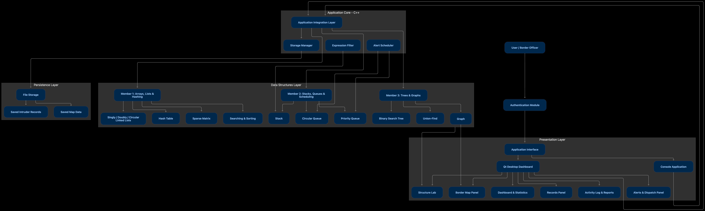

# Border Command Center

**A border surveillance and response system built to demonstrate Data Structures in C++.**

> Course: CS2301 – Data Structures · Vishwakarma Institute of Technology
> Language: C++ (console core + Qt desktop dashboard)
> Status: see [Project Progress](#project-progress)

---

## Table of Contents

1. [Overview](#overview)
2. [Problem Statement](#problem-statement)
3. [Key Features](#key-features)
4. [How the System Works](#how-the-system-works)
5. [Data Structures and Where They Are Used](#data-structures-and-where-they-are-used)
6. [Syllabus Coverage](#syllabus-coverage)
7. [Complexity Analysis](#complexity-analysis)
8. [Architecture and Folder Structure](#architecture-and-folder-structure)
9. [User Interface](#user-interface)
10. [Build and Run](#build-and-run)
11. [Team and Work Division](#team-and-work-division)
12. [Project Progress](#project-progress)
13. [Roadmap](#roadmap)
14. [Testing](#testing)
15. [Future Scope](#future-scope)
16. [Credits](#credits)

---

## Overview

Border Command Center started as a console program (the *Border Surveillance Alert System*) that stored intruder records in a fixed array and offered add, display, search, update, delete and statistics options with an admin login and file storage.

This project upgrades it into a full **surveillance and response system**:

- Border checkpoints and patrol routes form a **graph (map)**.
- Intruder sightings are **registered, searched, sorted and stored** using several data structures.
- Alerts are **queued and prioritized**, then **dispatched** to patrol units along the shortest route.
- A **Qt dashboard** shows the map, records and alerts, and also **visualizes the data structures live**, so a registration can be watched moving through a linked list, hash table, BST and stack.

Every core data structure and algorithm is **implemented from scratch** (no STL containers for the core structures) so the work demonstrates the course content directly.

## Problem Statement

A border monitoring unit needs to:

1. Record intruder sightings quickly and reliably.
2. Retrieve any record fast by ID or name.
3. Decide which alerts to handle first.
4. Send the nearest patrol unit along the best route, and reroute if a path is blocked.
5. Keep a history of actions with the ability to undo mistakes.

The project solves these using the data structures taught in the course, choosing each one for a clear reason.

## Key Features

**Records and search**
- Add, edit, delete intruder records with input validation
- Fast lookup by ID (hash table)
- Search by name with prefix suggestions (BST)
- Linear vs binary search comparison with timing
- Sort by threat level, name or location using bubble, insertion, merge and quick sort, with pass and comparison counts
- Sightings sparse matrix (checkpoint × time slot)

**Alerts and dispatch**
- Incoming alert queue (circular queue)
- Priority-based dispatch (priority queue): highest threat first
- Job scheduling of alerts to available patrol units
- Patrol duty rotation (Josephus problem, circular linked list)
- Alert rule filter: officers type rules such as `threat >= 4 AND zone == North`, converted from infix to postfix and evaluated with a stack

**Map and routing**
- Border map stored as a graph (adjacency list and adjacency matrix)
- Shortest route from a patrol unit to a sighting (Dijkstra)
- Block a route and recompute
- Reachability and connectivity checks (BFS, DFS)
- Bipartite check (two-zone patrol assignment) and cycle detection (redundant routes)
- Minimum cost communication network (Prim's and Kruskal's with Union-Find)

**System**
- Admin login with 3-attempt lockout and roles
- Undo of the last actions (stack)
- Activity log (doubly linked list)
- File save and load
- Dashboard, statistics and report export
- **Structure Lab**: live visual view of the data structures

## How the System Works

### Typical workflow

```
Register intruder
      │
      ├─► Singly linked list      (master record store)
      ├─► Hash table              (lookup by ID)
      ├─► BST                     (search by name)
      ├─► Undo stack              (push "ADD #id")
      ├─► Activity log            (doubly linked list)
      └─► Sightings sparse matrix (checkpoint × time slot)
      │
      ▼
   Create alert ──► Alert queue ──► Priority queue (by threat level)
                                          │
                                          ▼
                                 Scheduler picks next alert
                                          │
                                          ▼
                     Dijkstra finds nearest patrol unit's route on the map
                                          │
                                          ▼
                        Dispatch ──► status: Active → Dispatched → Resolved
```

### Step-by-step example

1. An officer logs in (3 attempts, then lockout).
2. They register an intruder: ID `105`, location `Checkpoint C`, threat level `5`.
3. The record is appended to the linked list, hashed into a bucket, and inserted into the BST by name.
4. `ADD #105` is pushed on the undo stack, and an entry is added to the activity log.
5. Because threat is high, an alert enters the priority queue.
6. The scheduler picks the highest-threat alert and assigns the nearest free unit.
7. Dijkstra computes the route, and the map highlights it.
8. The officer marks the alert resolved. Pressing **Undo** reverses the last action across all structures.

## Data Structures and Where They Are Used

| Structure / Algorithm | Role in the project |
|---|---|
| Arrays, vectors | Sorting and searching workspace, UI-facing lists |
| Singly linked list | Master intruder record store (no 100-record limit) |
| Doubly linked list | Activity log with forward and backward navigation |
| Circular linked list | Patrol shift rotation (Josephus problem) |
| Sparse matrix | Sightings per checkpoint and time slot |
| Stack | Undo, infix-to-postfix evaluation, iterative traversals, DFS |
| Circular queue | Incoming alert buffer |
| Priority queue | Dispatch order by threat level |
| Binary tree and BST | Name-based search, sorted display, traversals |
| Graph (list and matrix) | Border checkpoint map |
| BFS / DFS | Reachability, fewest-hops path, connectivity |
| Bipartite check | Two-zone patrol assignment |
| Cycle detection | Redundant route detection |
| Dijkstra | Fastest patrol route |
| Prim's / Kruskal's, Union-Find | Cheapest communication network |
| Hash table | ID lookup, with chaining and linear probing |
| Sorting (bubble, insertion, merge, quick) | Ordering records, with algorithm comparison |
| Searching (linear, binary) | Record lookup comparison |

## Syllabus Coverage

All features map to the CS2301 syllabus.

| Unit | Topic | Where it is used |
|---|---|---|
| 1. Arrays | Searching, sorting, sparse matrix, complexity | Search and sort panel, sightings matrix, complexity report |
| 2. Linked Lists | Singly, doubly, circular, vectors | Record store, activity log, patrol rotation |
| 3. Stacks and Queues | Array and linked implementations, expression conversion, queue types, job scheduling, Josephus | Undo, rule filter, alert queue, dispatch, shift rotation |
| 4. Trees | Binary tree, traversals (recursive and non-recursive), BST | Name search tree and traversal views |
| 5. Graphs | Representations, BFS/DFS, connected, bipartite, cycles, MST, shortest path, Union-Find | Border map and routing |
| 6. Hashing | Hash table, functions, collision handling | ID lookup, chaining vs probing |

## Complexity Analysis

*n = number of elements, V = vertices, E = edges.*

| Operation | Structure | Time complexity |
|---|---|---|
| Linear search | Array | O(n) |
| Binary search | Sorted array | O(log n) |
| Bubble / insertion sort | Array | O(n²) |
| Merge sort | Array | O(n log n) |
| Quick sort | Array | O(n log n) average, O(n²) worst |
| Insert at head / tail (with tail pointer) | Linked list | O(1) |
| Search | Linked list | O(n) |
| Push / pop | Stack | O(1) |
| Enqueue / dequeue | Circular queue | O(1) |
| Insert / remove highest | Priority queue (sorted linked list) | O(n) / O(1) |
| Insert / search | BST | O(log n) average, O(n) worst |
| Traversals | Binary tree | O(n) |
| Insert / search | Hash table | O(1) average, O(n) worst |
| BFS / DFS | Graph (adjacency list) | O(V + E) |
| Dijkstra | Graph (array-based) | O(V²) |
| Prim's | Graph (array-based) | O(V²) |
| Kruskal's | Graph + Union-Find | O(E log E) |
| Union / Find | Union-Find with path compression | Nearly O(1) amortized |
| Infix to postfix | Stack | O(n) |

## Architecture and Folder Structure

### System Architecture Diagram



The system is organized into four layers:

| Layer | Contents | Responsibility |
|---|---|---|
| **Presentation** | Application interface, Qt desktop dashboard, console application. Panels: Structure Lab, Border Map, Dashboard and Statistics, Records, Activity Log and Reports, Alerts and Dispatch | What the officer sees and interacts with. The Qt dashboard and the console app are two front ends over the same core. |
| **Application Core (C++)** | Application integration layer, storage manager, expression filter, alert scheduler | Wires the data structures together into the actual workflows (register, alert, dispatch, undo, save/load). |
| **Data Structures** | Member 1: linked lists, hash table, sparse matrix, searching and sorting. Member 2: stack, circular queue, priority queue. Member 3: BST, Union-Find, graph | The from-scratch implementations. No UI code lives here. |
| **Persistence** | File storage with saved intruder records and saved map data | Keeps data between runs. |

The officer logs in through the **authentication module** before reaching the application interface. The **Structure Lab** and **Border Map** panels read directly from the graph and structure state, while all other panels go through the integration layer.

### Folder Structure

The design keeps **data structures free of any UI code**. The console test programs and the Qt interface both call the same core code.

```
BorderCommandCenter/
├── common/
│   └── Intruder.h              Shared data model (agreed and frozen)
│
├── person1/                    Arrays, linked lists, hashing
│   ├── Searching.h / .cpp
│   ├── Sorting.h / .cpp
│   ├── SparseMatrix.h / .cpp
│   ├── LinkedList.h            Singly, doubly, circular
│   ├── HashTable.h / .cpp
│   ├── Josephus.cpp
│   └── test_person1.cpp
│
├── person2/                    Stacks, queues, application core
│   ├── Stack.h
│   ├── Queue.h                 Circular queue + priority queue
│   ├── ExpressionFilter.h / .cpp
│   ├── Scheduler.h / .cpp
│   ├── Auth.h / .cpp
│   ├── Storage.h / .cpp
│   └── test_person2.cpp
│
├── person3/                    Trees and graphs
│   ├── BST.h / .cpp
│   ├── Graph.h / .cpp
│   ├── GraphAlgorithms.h / .cpp
│   ├── UnionFind.h
│   └── test_person3.cpp
│
├── app_console.cpp             Integrated console version (Phase 2)
├── ui/                         Qt dashboard (Phase 3)
├── data/                       Saved records and map files
├── docs/
│   └── architecture.png        System architecture diagram
├── CMakeLists.txt
└── README.md
```

### Design rules

- No `cin` or `cout` inside the data structure classes. Only test files and the UI print or read.
- Template classes live entirely in `.h` files.
- Standard method names across all structures: `insert`, `remove`, `search`, `display`, `size`, `isEmpty`.
- Every structure provides `exportState()` returning its contents in a simple form. The Qt **Structure Lab** draws these, so the visualization never touches the internals.
- Each team member works only in their own folder, which avoids merge conflicts.

## User Interface

The Qt dashboard uses a dark theme with a left navigation bar. Planned screens:

| Screen | Description |
|---|---|
| Login | Credentials, attempts remaining, role-based access |
| Dashboard | Stat cards (total, high threat, active alerts, free units), threat chart |
| Map | Checkpoint graph, intruder markers, animated shortest route, blocked routes, MST overlay |
| Records | Sortable table, search with suggestions, add/edit/delete forms, sort algorithm selector |
| Alerts | Priority queue view with a Dispatch button |
| Structure Lab | Live views of the linked list, hash table buckets, BST, undo stack, queues, graph and sorting passes, with a step log explaining each operation and its cost |
| Activity Log | Scrollable history |
| Reports | Statistics and CSV export |

## Build and Run

### Requirements

- C++17 compiler (g++ 9+ or MSVC 2019+)
- Qt 6 (Widgets), only needed for the GUI phase
- CMake 3.16+ (recommended)

### Console tests (each person)

```bash
g++ -std=c++17 -I common person1/*.cpp -o test1 && ./test1
g++ -std=c++17 -I common person2/*.cpp -o test2 && ./test2
g++ -std=c++17 -I common person3/*.cpp -o test3 && ./test3
```

### Integrated console app

```bash
g++ -std=c++17 -I common person1/*.cpp person2/*.cpp person3/*.cpp app_console.cpp -o border_console
./border_console
```

### Qt dashboard

```bash
mkdir build && cd build
cmake ..
cmake --build .
./BorderCommandCenter
```

## Team and Work Division

| Member | Focus | Syllabus units | Qt panels (later) |
|---|---|---|---|
| **[Member 1]** | Arrays, searching and sorting, sparse matrix, linked lists, hashing, Josephus | 1, 2, 6 | Records table, sort/search panel, hash and list views, sparse matrix view |
| **[Member 2]** | Stacks, queues, scheduling, expression filter, login, storage, main window shell | 3 | Main window, login, alerts and dispatch, stack and queue views, dashboard |
| **[Member 3]** | BST, graphs, shortest path, MST, Union-Find | 4, 5 | Map view, BST view, algorithm overlays |

Original console prototype (array-based Border Surveillance Alert System): Pragati Patil.

## Project Progress

*Update this table as work is completed.*

### Foundation

| Item | Status |
|---|---|
| Original console prototype (add, display, search, update, delete, statistics, login, file storage) | Done |
| Project scope finalized and mapped to syllabus | Done |
| Work split across three members | Done |
| Repository, folder structure and branches set up | To do |
| `Intruder.h` shared model agreed | To do |
| Standard method names and `exportState()` pattern agreed | To do |

### Phase 1: Data structures (console, separate folders)

| Component | Owner | Status |
|---|---|---|
| Searching (linear, binary) | Member 1 | To do |
| Sorting (bubble, insertion, merge, quick) | Member 1 | To do |
| Sparse matrix | Member 1 | To do |
| Singly, doubly, circular linked lists | Member 1 | To do |
| Hash table (chaining and probing) | Member 1 | To do |
| Josephus rotation | Member 1 | To do |
| Stack (array and linked) | Member 2 | To do |
| Circular queue and priority queue | Member 2 | To do |
| Infix to postfix rule filter | Member 2 | To do |
| Job scheduler | Member 2 | To do |
| Login, roles, file storage | Member 2 | To do |
| BST and traversals (recursive and iterative) | Member 3 | To do |
| Graph (list and matrix), BFS, DFS | Member 3 | To do |
| Connectivity, bipartite, cycle detection | Member 3 | To do |
| Dijkstra, Prim's, Kruskal's, Union-Find | Member 3 | To do |

### Phase 2: Integration (console)

| Item | Status |
|---|---|
| `app_console.cpp` wiring all structures | To do |
| Full workflow test (register, alert, dispatch, undo, save/load) | To do |

### Phase 3: Qt dashboard

| Item | Status |
|---|---|
| Main window and navigation shell | To do |
| Login screen | To do |
| Records panel | To do |
| Map panel | To do |
| Alerts and dispatch panel | To do |
| Structure Lab (data structure visualizer) | To do |
| Dashboard and reports | To do |
| Theme and polish | To do |

### Final

| Item | Status |
|---|---|
| Testing and bug fixing | To do |
| Report with complexity analysis | To do |
| Demo rehearsal | To do |

## Roadmap

| Week | Goal |
|---|---|
| 0 | Repository setup, shared model and conventions agreed |
| 1–3 | Phase 1: each member builds and tests their structures in the console |
| 4 | Phase 2: integrate everything into one console application |
| 5–6 | Phase 3: Qt dashboard and Structure Lab |
| Final days | Testing, report, viva practice |

**Priority order if time is short:** complete console version first (satisfies the syllabus on its own), then the main Qt screens, then Structure Lab animations, then optional extras.

## Testing

- Each structure has a console test that inserts, searches, deletes and prints.
- Edge cases to cover: empty structures, full queue, duplicate IDs, unreachable graph nodes, hash collisions, corrupted save file, invalid input.
- Integration scenarios: register then undo, dispatch with a blocked route, save then reload.

## Future Scope

- Role-based permissions with hashed passwords
- Simulation mode generating random alerts for live demonstration
- Real map coordinates and GPS-style positions
- Network synchronization between multiple control stations
- Threat scoring based on location sensitivity and time since sighting

## Credits

- Course: CS2301 Data Structures, Vishwakarma Institute of Technology
- Original console prototype: Pragati Patil
- Team: [Member 1], [Member 2], [Member 3]
- Faculty guide: [Name]
